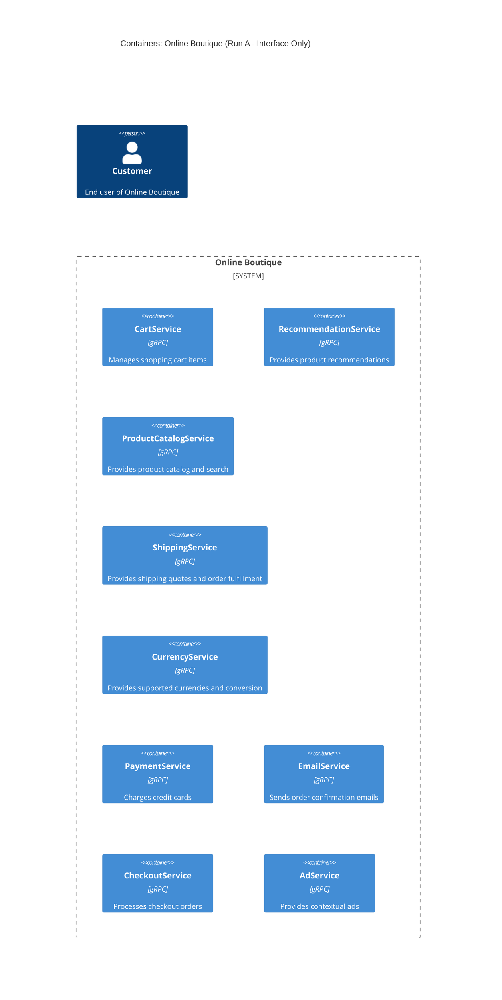

# Architecture Recovery - Run A

## 1. Agent
- **Product Name:** Antigravity (Google DeepMind)
- **Model:** Gemini 3.8 Flash (High)

## 2. Files read
- `system/online-boutique/protos/demo.proto`

## 3. Containers table

| Name | Technology / Language | Responsibility | Evidence (File Path) |
|---|---|---|---|
| CartService | gRPC Service (Implementation language not evidenced) | Manages shopping cart items (`AddItem`, `GetCart`, `EmptyCart`) | `system/online-boutique/protos/demo.proto:23-27` |
| RecommendationService | gRPC Service (Implementation language not evidenced) | Generates product recommendations based on user/product list (`ListRecommendations`) | `system/online-boutique/protos/demo.proto:56-58` |
| ProductCatalogService | gRPC Service (Implementation language not evidenced) | Provides product listing, item retrieval, and search (`ListProducts`, `GetProduct`, `SearchProducts`) | `system/online-boutique/protos/demo.proto:71-75` |
| ShippingService | gRPC Service (Implementation language not evidenced) | Generates shipping quotes and ships orders (`GetQuote`, `ShipOrder`) | `system/online-boutique/protos/demo.proto:107-110` |
| CurrencyService | gRPC Service (Implementation language not evidenced) | Provides supported currency listing and currency conversion (`GetSupportedCurrencies`, `Convert`) | `system/online-boutique/protos/demo.proto:140-143` |
| PaymentService | gRPC Service (Implementation language not evidenced) | Processes credit card charges (`Charge`) | `system/online-boutique/protos/demo.proto:177-179` |
| EmailService | gRPC Service (Implementation language not evidenced) | Sends order confirmation emails (`SendOrderConfirmation`) | `system/online-boutique/protos/demo.proto:199-201` |
| CheckoutService | gRPC Service (Implementation language not evidenced) | Orchestrates placing an order (`PlaceOrder`) | `system/online-boutique/protos/demo.proto:224-226` |
| AdService | gRPC Service (Implementation language not evidenced) | Provides contextual text advertisements (`GetAds`) | `system/online-boutique/protos/demo.proto:243-245` |

## 4. Dependencies table

| Caller → Callee | Protocol | Evidence (File Path & Symbol) |
|---|---|---|
| *(No runtime caller-callee dependencies are evidenced)* | *(None)* | Not evidenced in the provided file (`demo.proto` defines server RPC interfaces, not client calls) |

## 5. Mermaid diagram

## 6. Gaps
1. **Runtime Caller-to-Callee Dependencies:** `demo.proto` defines service contracts and RPC signatures (server-side interface definitions), but does not reveal which service invokes which other service. Determining runtime caller dependencies requires access to deployment manifests (environment variables such as `*_SERVICE_ADDR`) or application source code.
2. **Frontend / Web UI / Ingress:** No HTTP web server, UI gateway, or entrypoint container is defined as an RPC service in `demo.proto`. Discovering the frontend container requires inspecting Kubernetes deployment manifests (`kubernetes-manifests/frontend.yaml`) or source directories (`src/frontend/`).
3. **Data Stores / Databases / Caches:** `demo.proto` does not declare any databases, persistence mechanisms, or caches (such as Redis or SQL). Determining data persistence requires inspecting Kubernetes deployment configs (`kubernetes-manifests/`) or source code.
4. **Implementation Technologies / Languages:** With the exception of `option go_package`, the runtime programming language (e.g. Go, Java, Python, Node.js, C#) of each individual microservice is not evidenced in `demo.proto`. Inspecting `Dockerfile`s or source directory structures would settle this.
5. **External Third-Party Systems:** No external APIs or payment processors are explicitly defined in `demo.proto`.
