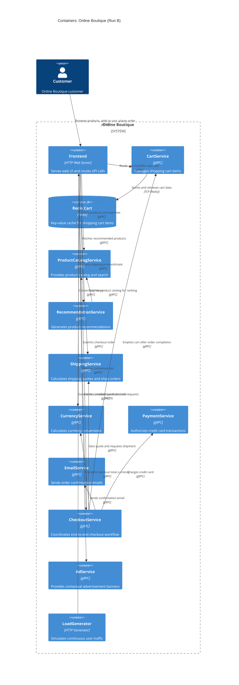

# Architecture Recovery - Run B

## 1. Agent
- **Product Name:** Antigravity (Google DeepMind)
- **Model:** Gemini 3.8 Flash (High)

## 2. Files read
- `system/online-boutique/protos/demo.proto`
- `system/online-boutique/kubernetes-manifests/kustomization.yaml`
- `system/online-boutique/kubernetes-manifests/frontend.yaml`
- `system/online-boutique/kubernetes-manifests/cartservice.yaml`
- `system/online-boutique/kubernetes-manifests/productcatalogservice.yaml`
- `system/online-boutique/kubernetes-manifests/currencyservice.yaml`
- `system/online-boutique/kubernetes-manifests/paymentservice.yaml`
- `system/online-boutique/kubernetes-manifests/shippingservice.yaml`
- `system/online-boutique/kubernetes-manifests/emailservice.yaml`
- `system/online-boutique/kubernetes-manifests/checkoutservice.yaml`
- `system/online-boutique/kubernetes-manifests/recommendationservice.yaml`
- `system/online-boutique/kubernetes-manifests/adservice.yaml`
- `system/online-boutique/kubernetes-manifests/loadgenerator.yaml`

## 3. Containers table

| Name | Technology / Language | Responsibility | Evidence (File Path) |
|---|---|---|---|
| frontend | HTTP Web Server / Reverse Proxy (`image: frontend`) | Serves web UI to users and routes API requests to backend gRPC services | `system/online-boutique/kubernetes-manifests/frontend.yaml:18,39,47` |
| cartservice | gRPC Service (`image: cartservice`) | Stores and manages items in users' shopping carts | `system/online-boutique/kubernetes-manifests/cartservice.yaml:18,46`, `system/online-boutique/protos/demo.proto:23` |
| redis-cart | Key-Value Data Store (`image: redis:alpine`) | Persists shopping cart key-value pairs | `system/online-boutique/kubernetes-manifests/cartservice.yaml:92,110,118` |
| productcatalogservice | gRPC Service (`image: productcatalogservice`) | Provides product catalog list, item lookups, and text search | `system/online-boutique/kubernetes-manifests/productcatalogservice.yaml:18,46`, `system/online-boutique/protos/demo.proto:71` |
| currencyservice | gRPC Service (`image: currencyservice`) | Calculates exchange rates and lists supported currencies | `system/online-boutique/kubernetes-manifests/currencyservice.yaml:18,46`, `system/online-boutique/protos/demo.proto:140` |
| paymentservice | gRPC Service (`image: paymentservice`) | Validates and charges credit card transactions | `system/online-boutique/kubernetes-manifests/paymentservice.yaml:18,46`, `system/online-boutique/protos/demo.proto:177` |
| shippingservice | gRPC Service (`image: shippingservice`) | Computes shipping price quotes and ships orders | `system/online-boutique/kubernetes-manifests/shippingservice.yaml:18,46`, `system/online-boutique/protos/demo.proto:107` |
| emailservice | gRPC Service (`image: emailservice`) | Formats and sends customer order confirmation emails | `system/online-boutique/kubernetes-manifests/emailservice.yaml:18,46`, `system/online-boutique/protos/demo.proto:199` |
| checkoutservice | gRPC Service (`image: checkoutservice`) | Orchestrates the entire checkout workflow and coordinates supporting services | `system/online-boutique/kubernetes-manifests/checkoutservice.yaml:18,45`, `system/online-boutique/protos/demo.proto:224` |
| recommendationservice | gRPC Service (`image: recommendationservice`) | Computes and returns recommended products | `system/online-boutique/kubernetes-manifests/recommendationservice.yaml:18,46`, `system/online-boutique/protos/demo.proto:56` |
| adservice | gRPC Service (`image: adservice`) | Serves contextual targeted banner advertisements | `system/online-boutique/kubernetes-manifests/adservice.yaml:18,46`, `system/online-boutique/protos/demo.proto:243` |
| loadgenerator | Synthetic Traffic Generator (`image: loadgenerator`) | Sends automated synthetic user browsing and purchasing requests to frontend | `system/online-boutique/kubernetes-manifests/loadgenerator.yaml:17,80` |

## 4. Dependencies table

| Caller → Callee | Protocol | Evidence (File Path & Symbol) |
|---|---|---|
| Customer → frontend | HTTP | `system/online-boutique/kubernetes-manifests/frontend.yaml:126-136` (`Service/frontend-external`, port 80) |
| loadgenerator → frontend | HTTP | `system/online-boutique/kubernetes-manifests/loadgenerator.yaml:69-70,82-83` (`FRONTEND_ADDR="frontend:80"`) |
| frontend → productcatalogservice | gRPC | `system/online-boutique/kubernetes-manifests/frontend.yaml:69-70` (`PRODUCT_CATALOG_SERVICE_ADDR="productcatalogservice:3550"`) |
| frontend → currencyservice | gRPC | `system/online-boutique/kubernetes-manifests/frontend.yaml:71-72` (`CURRENCY_SERVICE_ADDR="currencyservice:7000"`) |
| frontend → cartservice | gRPC | `system/online-boutique/kubernetes-manifests/frontend.yaml:73-74` (`CART_SERVICE_ADDR="cartservice:7070"`) |
| frontend → recommendationservice | gRPC | `system/online-boutique/kubernetes-manifests/frontend.yaml:75-76` (`RECOMMENDATION_SERVICE_ADDR="recommendationservice:8080"`) |
| frontend → shippingservice | gRPC | `system/online-boutique/kubernetes-manifests/frontend.yaml:77-78` (`SHIPPING_SERVICE_ADDR="shippingservice:50051"`) |
| frontend → checkoutservice | gRPC | `system/online-boutique/kubernetes-manifests/frontend.yaml:79-80` (`CHECKOUT_SERVICE_ADDR="checkoutservice:5050"`) |
| frontend → adservice | gRPC | `system/online-boutique/kubernetes-manifests/frontend.yaml:81-82` (`AD_SERVICE_ADDR="adservice:9555"`) |
| checkoutservice → productcatalogservice | gRPC | `system/online-boutique/kubernetes-manifests/checkoutservice.yaml:57-58` (`PRODUCT_CATALOG_SERVICE_ADDR="productcatalogservice:3550"`) |
| checkoutservice → shippingservice | gRPC | `system/online-boutique/kubernetes-manifests/checkoutservice.yaml:59-60` (`SHIPPING_SERVICE_ADDR="shippingservice:50051"`) |
| checkoutservice → paymentservice | gRPC | `system/online-boutique/kubernetes-manifests/checkoutservice.yaml:61-62` (`PAYMENT_SERVICE_ADDR="paymentservice:50051"`) |
| checkoutservice → emailservice | gRPC | `system/online-boutique/kubernetes-manifests/checkoutservice.yaml:63-64` (`EMAIL_SERVICE_ADDR="emailservice:5000"`) |
| checkoutservice → currencyservice | gRPC | `system/online-boutique/kubernetes-manifests/checkoutservice.yaml:65-66` (`CURRENCY_SERVICE_ADDR="currencyservice:7000"`) |
| checkoutservice → cartservice | gRPC | `system/online-boutique/kubernetes-manifests/checkoutservice.yaml:67-68` (`CART_SERVICE_ADDR="cartservice:7070"`) |
| recommendationservice → productcatalogservice | gRPC | `system/online-boutique/kubernetes-manifests/recommendationservice.yaml:60-61` (`PRODUCT_CATALOG_SERVICE_ADDR="productcatalogservice:3550"`) |
| cartservice → redis-cart | TCP (Redis) | `system/online-boutique/kubernetes-manifests/cartservice.yaml:50-51` (`REDIS_ADDR="redis-cart:6379"`) |

## 5. Mermaid diagram

## 6. Gaps
1. **Shopping Assistant Service:** In `frontend.yaml:83-84`, `SHOPPING_ASSISTANT_SERVICE_ADDR="shoppingassistantservice:80"` is defined. However, `ENABLE_ASSISTANT` is commented out (`frontend.yaml:93`) and no corresponding deployment exists in `kubernetes-manifests/` (it is commented out in `kustomization.yaml:35`). Settling whether this service is implemented or inactive requires inspecting `src/frontend/` and `kustomize/components/shopping-assistant`.
2. **Programming Languages of Services:** The container manifests specify container image names (e.g. `image: frontend`, `image: cartservice`) without detailing the actual implementation language (e.g. Go, Java, Python, Node.js, C#). Reading source directories (`system/online-boutique/src/`) would settle this.
3. **External Payment Gateway & Mail Server:** `paymentservice` and `emailservice` manifests declare internal gRPC endpoints but do not configure outbound third-party credentials or external endpoints (e.g., Stripe, SendGrid). Settling whether these services mock external providers or integrate externally requires inspecting their source code (`src/paymentservice/` and `src/emailservice/`).
